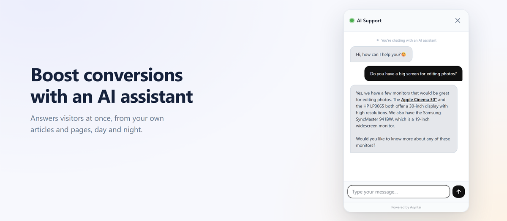
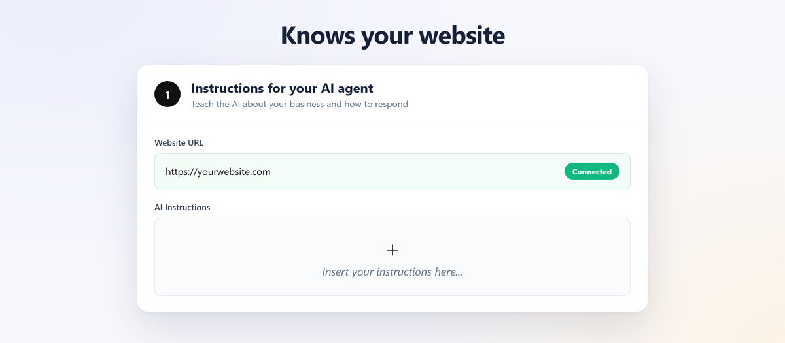
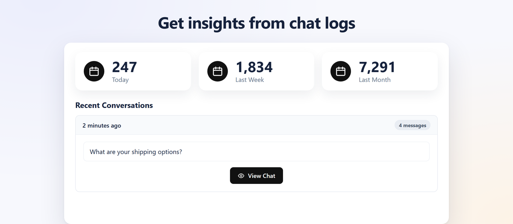
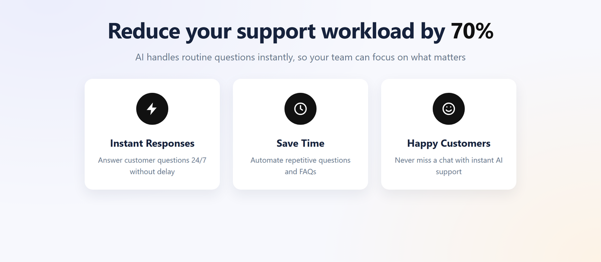
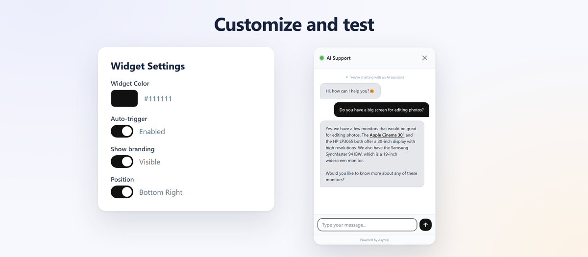

# Asyntai AI Chatbot For Strapi

Create and launch AI assistant/chatbot for your Strapi website in minutes. It talks to your visitors, helps, explains, never misses a chat and can increase conversion rates! All while knowing your Strapi website, customized just for you. Your Strapi website can now talk.

This plugin embeds the Asyntai chatbot on your site and provides a simple admin interface to connect your site to Asyntai.

## Why choose Asyntai?

• **Increase conversions**: Instant, human like replies keep shoppers engaged and buying.

• **Never miss a chat**: The AI replies day and night, even when your team is offline.

• **Knows your website**: Customized just for you; it follows your instructions.

• **Always up to date**: Share your published Strapi content with the chatbot directly, so its answers follow every change you make.

• **Works in all languages**: Automatically detects and answers in the visitor's language.

• **Fast responses (1–3s)**: Keeps customers from bouncing.


## Installation

1. Install the plugin:
   ```bash
   npm install @asyntai/strapi-plugin-chatbot
   ```

2. Enable the plugin in your `config/plugins.ts` (or `config/plugins.js`):
   ```typescript
   export default {
     'asyntai-chatbot': {
       enabled: true,
     },
   };
   ```

3. Rebuild and restart your Strapi server:
   ```bash
   npm run build
   npm run develop
   ```

4. Navigate to Admin Panel → Asyntai AI Chatbot

Note: Alternatively, if you don't want to use a plugin, you can also get a JavaScript snippet at [asyntai.com/dashboard](https://asyntai.com/dashboard) and manually insert it into your web pages.

## Configuration

After installation:

1. Go to Admin Panel → Asyntai AI Chatbot (in the left sidebar)
2. Leave "Let the chatbot read my published content directly" ticked to share your content with the chatbot
3. Click "Get started" to connect your Asyntai account
4. Sign in or create a free account
5. The plugin will automatically save your connection
6. Choose which content types to share (at first, the ones your Public role can already read)
7. Copy the JavaScript snippet and add it to your frontend pages
8. Set up your chatbot, review chat logs and more at: [asyntai.com/dashboard](https://asyntai.com/dashboard)

Don't have an account yet? Create a free Asyntai account at [asyntai.com/auth](https://asyntai.com/auth)

## Managing Your Chatbot

Once connected, you can manage your chatbot settings, review chat logs, and customize AI responses at:
[asyntai.com/dashboard](https://asyntai.com/dashboard)


## Requirements

- Strapi 5.0 or higher
- Node.js 18.0 or higher
- Super Admin access for configuration
- If your Strapi version is not compatible, you can still use Asyntai by getting a JavaScript snippet from [asyntai.com/dashboard](https://asyntai.com/dashboard)


## Have a question?
Email us at hello@asyntai.com or try our chatbot directly at [asyntai.com/](https://asyntai.com/)











